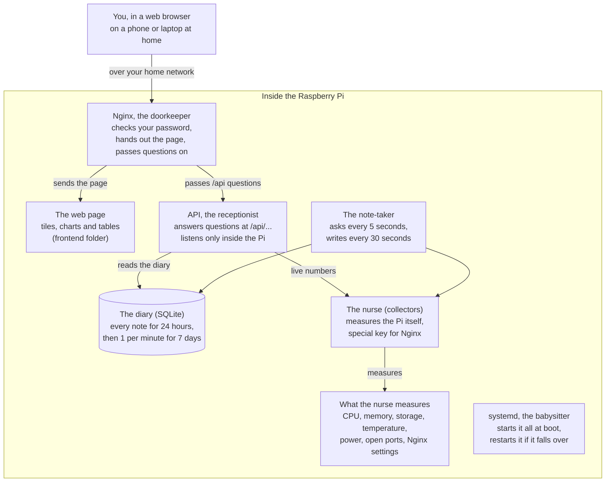

# Pi Vitals: How It Works (Explained for a 10-Year-Old)

The system design and architecture of Pi Vitals in plain words. Every kid word comes with the grown-up word engineers use, so you can go from this page straight into the code.

_Last updated: 2026-10-21. Keep this file in step with the code: when the architecture changes, update it in the same change._

## What is Pi Vitals?

Pi Vitals is a doctor's check-up for a Raspberry Pi that lives on the Pi itself, and you read the results on a web page.

A Raspberry Pi is a tiny computer, about the size of a pack of cards. Like a person, it can get hot, get tired, or run out of room. A doctor checks your vital signs: your temperature, your heartbeat, your breathing. Pi Vitals checks the Pi's vital signs every 5 seconds:

- **How hard its brain is working** (the CPU)
- **How full its short-term memory is** (the memory, or RAM)
- **How full its backpack is** (the storage, its SD card)
- **How hot it is** (the temperature)
- **Whether it is getting enough power** (under-voltage and throttling)
- **Which doors are open** to other computers (the open ports)
- **How its receptionist is set up** (the Nginx settings)

It writes every check into a diary that it keeps for 7 days, and turns the diary into pictures (charts). You open the page on a phone or laptop at home, type a password, and see how your Pi is feeling right now and over the past week.

## The big picture

Your browser only ever talks to one helper, the doorkeeper (Nginx); everything else stays safely inside the Pi.

Read it from the top: you ask the doorkeeper, it hands you the page or passes your question to the receptionist (the API), and the receptionist either asks the nurse for numbers right now or reads them from the diary. The note-taker fills the diary in the background, and the babysitter keeps everyone running.

## Meet the team

Pi Vitals is a team of small helpers, and each one has exactly one job.

Think of a tiny clinic inside the Pi. Here is who works there, what they do in kid words, and the name grown-ups use for them.

| Helper | Their job | Grown-up name | Where it lives |
| --- | --- | --- | --- |
| The nurse | Measures the Pi: brain, memory, backpack, temperature, power, open doors, Nginx settings | Collectors | `backend/app/collectors/` |
| The note-taker | Every 5 seconds asks the nurse for numbers, keeps the notes in a pocket, and copies them into the diary every 30 seconds | Sampler (a background thread) | `backend/app/scheduler.py` |
| The diary | Remembers every note for a day, then keeps one summary per minute for 7 days, then throws the old pages away | SQLite database | `backend/app/db.py` |
| The receptionist | Answers questions like "how hot is the Pi right now?" or "show me the last hour" | API (FastAPI) | `backend/app/main.py` |
| The picture board | The web page with tiles, charts and tables; asks the receptionist for fresh numbers every 5 seconds | Frontend (HTML, CSS, JavaScript, uPlot charts) | `frontend/` |
| The doorkeeper | Checks your password, hands you the web page, and passes your questions to the receptionist | Nginx (web server and reverse proxy) | `deploy/nginx-pi-vitals.conf` |
| The babysitter | Starts Pi Vitals when the Pi turns on, and picks it back up if it falls over | systemd service | `deploy/pi-vitals.service` |
| The special key | Lets the nurse read Nginx's settings with exactly two commands, and opens nothing else | sudo rule | `deploy/sudoers-pi-vitals` |
| The builder | Sets up the whole clinic on a Pi with one command | Install script | `deploy/install.sh` |

The nurse never talks to you directly, and you never talk to the receptionist directly. Every question goes through the doorkeeper first.

## A day in the life of a number

One CPU reading takes six steps to go from the Pi's brain to a line on your screen, and it is thrown away after 7 days.

Follow one number, "the brain was 23% busy", on its trip:

1. **The note-taker wakes up.** Every 5 seconds it asks the nurse how busy the brain has been. The nurse looks at the Pi's work counter, compares it with the last time it looked, and says "busy 23% of the time".
2. **Into the pocket.** The note goes into the note-taker's pocket (a list in memory), together with memory, temperature, storage and load.
3. **Into the diary, in a batch.** Every 30 seconds, all the notes in the pocket are written into the diary at once. Six notes, one write. That is gentler on the SD card (see "Keeping the Pi happy").
4. **You ask for a chart.** When you open the page, it asks the receptionist for `/api/history?range=1h`. The receptionist reads the diary, groups the notes into about 300 points, and sends them back.
5. **The page draws it.** The picture board draws a line. Point at it and a little box shows the exact value and time. Press **Table** and you get the same numbers as a list.
6. **Tidy-up time.** Once an hour, notes older than a day are squashed into one average per minute. After 7 days they are thrown away, so the diary never fills the backpack.

The four big tiles at the top take a shortcut. Every 5 seconds the page asks `/api/live`, and the receptionist asks the nurse directly, without the diary.

## Keeping it safe

Pi Vitals can see private things, like which doors are open and how Nginx is set up, so it has eight locks, and each one stops a different kind of trouble.

| Lock | In kid words | What it stops |
| --- | --- | --- |
| Password at the front door | Nobody sees the page without the password | Strangers on your network peeking (Nginx basic auth) |
| The receptionist stays indoors | The receptionist only listens inside the Pi, never to the street | Anyone skipping the doorkeeper (the API listens on 127.0.0.1 only) |
| Look, don't touch | No button anywhere can change the Pi, and the doorkeeper refuses anything except "show me" | Anyone using the dashboard to break things (read-only API; Nginx allows only GET and HEAD) |
| A key for one cupboard | The special key opens exactly two Nginx commands, `nginx -T` and `nginx -v`, and nothing else | Pi Vitals growing into a master key (a narrow sudo rule, checked with `visudo` before it is installed) |
| A helper with few powers | Pi Vitals runs as its own user, `pivitals`, which owns almost nothing | Damage spreading if something goes wrong (a dedicated system user plus systemd restrictions) |
| Black marker on secrets | Passwords, keys and tokens in the Nginx settings are blacked out before you see them | Secrets leaking onto the screen (redaction) |
| Only our own scripts | The page only runs code that came from the Pi itself; fonts and icons are stored on the Pi too | Sneaky code from the internet (a strict Content-Security-Policy, no CDN) |
| A speed bump | Each visitor gets about 20 requests a second | Someone guessing passwords very fast (Nginx rate limit) |

One lock is weaker than it sounds: the password travels across your home Wi-Fi without a secret envelope (plain HTTP, not HTTPS). Use Pi Vitals only on a home network you trust, or through a private tunnel such as Tailscale, and never open it to the whole internet.

## Keeping the Pi happy

A doctor shouldn't make the patient sicker, so Pi Vitals is built to use as little of the Pi as it can.

- **Go easy on the SD card.** An SD card wears out from too much writing, a bit like an eraser that gets smaller each time you use it. So the note-taker writes in batches every 30 seconds instead of every 5. The diary keeps only one summary per minute after a day. Pi Vitals also does not write a log line every time the page asks for numbers.
- **Stay small.** The babysitter (systemd) stops Pi Vitals from using more than 256 MB of memory, and tells it to let more important jobs go first.
- **Pack light.** The chart library (uPlot) is about 50 KB and the font about 36 KB, so the page loads fast even on a slow network.
- **Only ask while someone is looking.** When you switch to another browser tab, the page stops asking for numbers until you come back.
- **Don't ask Nginx too often.** Reading the Nginx settings takes effort, so the answer is kept for 30 seconds and reused.

## Bugs we caught

The trickiest bug was a CPU reading that sometimes said 0% for no reason, and every bug here taught one rule worth remembering.

| Bug | What happened | How we fixed it | The lesson |
| --- | --- | --- | --- |
| The mystery 0% | The CPU number was sometimes 0%. The measuring tool (psutil) keeps a separate stopwatch for every worker (thread). The first time a new worker asked, its stopwatch had only just started, so it said 0. | We stopped using that tool's percent and keep one shared stopwatch for everyone, counting the Pi's work ticks ourselves. | A number can look fine and still be wrong. Check it against reality. |
| Asking too fast | Asking twice within a moment gave a made-up answer. | If the last check was less than 1.5 seconds ago, reuse the last answer. If there is no answer yet, say "no data", never a fake 0. | "I don't know yet" is more honest than a made-up number. |
| The word "null" on screen | The temperature tile showed "–null" on a computer with no temperature sensor. | A small helper now skips empty values instead of printing them. | Empty is not the same as the word "null". |
| The name too long for its box | One long folder name made the whole page slide sideways on a phone. | Long names now wrap onto the next line. | Always test on a small screen. |

## Where everything lives

The project has three main rooms: `backend/` does the measuring and remembering, `frontend/` draws the page, and `deploy/` sets it all up on a Pi.

| Place | What is inside |
| --- | --- |
| `backend/app/main.py` | The receptionist: every `/api/...` question and its answer |
| `backend/app/collectors/` | The nurse's tools: `system.py` (brain, memory), `health.py` (temperature, power), `storage.py` (backpack), `ports.py` (open doors), `nginx.py` (Nginx settings) |
| `backend/app/scheduler.py` | The note-taker |
| `backend/app/db.py` | The diary: saving, squashing and reading notes |
| `backend/app/config.py` | The settings you can change, all starting with `PIVITALS_` |
| `backend/tests/` | More than 100 automatic checks that run in under a second |
| `frontend/index.html` | The page itself |
| `frontend/js/` | The page's brain: `app.js` (tabs and asking every 5 seconds), `charts.js` (drawing), `views/` (Overview, Ports, Nginx) |
| `frontend/css/` | The look: `tokens.css` holds every colour, from the green palette |
| `frontend/fonts/`, `icons/`, `vendor/` | Google Sans, Lucide icons and uPlot, stored on the Pi so no internet is needed |
| `deploy/` | The builder (`install.sh`), the remover (`uninstall.sh`) and the settings for systemd, Nginx and sudo |
| `docs/` | Guides like this one |
| `PLAN.md`, `README.md`, `CLAUDE.md` | The plan in phases, the how-to for people, and the rules for Claude |

On a real Pi, the builder copies the app to `/opt/pi-vitals` and the diary lives in `/var/lib/pi-vitals`.

## Words to know

Every kid word in this guide has a grown-up word that engineers use, and knowing both lets you read the real code.

| Kid word | Grown-up word | What it means |
| --- | --- | --- |
| The Pi's brain | CPU | The part that does the thinking; its "%" says how busy it is |
| Short-term memory | RAM | What the Pi is holding in mind right now; it empties when the Pi turns off |
| The backpack | Storage, SD card | Where files are kept, even when the Pi is off |
| Running hot, slowing down | Temperature, throttling | When it gets too hot or has too little power, the Pi slows itself down to stay safe |
| A door | Port | A numbered door other computers can knock on, like 22 for remote login or 80 for websites |
| The doorkeeper | Nginx, reverse proxy | A program that receives web visitors and passes their questions to the right helper |
| The receptionist | API | The helper that answers questions in a fixed format other programs understand |
| A question | Endpoint, request | One address you can ask, such as `/api/live` |
| The diary | Database (SQLite) | An organised file that stores rows of numbers and finds them fast |
| Squashing old notes | Downsampling | Replacing many small readings with one average, to save space |
| A worker | Thread | One line of work inside a program; a program can have several at once |
| The babysitter | systemd service | The part of Linux that starts programs at boot and restarts them if they crash |
| The special key | sudo | A way to run one command with the computer's top-level powers |
| Black marker | Redaction | Hiding secret words before showing text |
| Only our own scripts | Content-Security-Policy (CSP) | A rule that tells the browser which code it may run |
| Inside the Pi only | localhost, 127.0.0.1 | An address that only the computer itself can reach |
